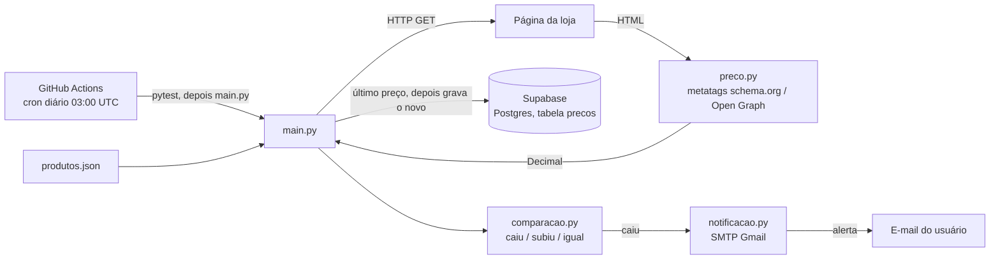

# Rastreador de Preços

> Job diário que monitora preços de produtos em lojas online, guarda o histórico e envia alerta por e-mail quando o preço cai.

[PREENCHER: GIF ou print da aplicação (saída no terminal e e-mail de alerta)]

## O problema

Acompanhar o preço de um produto exige abrir a página da loja todos os dias e lembrar quanto ele custava antes. Sem histórico, não dá para saber se uma "promoção" é de fato uma queda.

## A solução

Um script em Python, agendado no GitHub Actions, lê o preço de cada produto da lista uma vez por dia, compara com o último valor gravado no Postgres (Supabase) e, se o preço caiu, envia um e-mail com o valor anterior, o novo, a economia e o link do produto. Roda na nuvem, sem servidor próprio e sem o computador ligado.

## Arquitetura



## Funcionalidades

- Lista de produtos configurável em `produtos.json`.
- Extração do preço por metatags padrão (`itemprop="price"`, `product:price:amount`, `og:price:amount`), sem seletores específicos de cada loja.
- Histórico de preços no Postgres, com índice por produto e data.
- Classificação de cada leitura: primeira leitura, caiu, subiu ou sem mudança.
- Alerta por e-mail quando o preço cai.
- Falha em um produto não interrompe os outros; a execução termina com erro para o GitHub Actions avisar.
- Script separado para testar o envio de e-mail sem mexer no banco.

## Stack

- **Linguagem:** Python [PREENCHER: versão mínima testada; o workflow usa 3.14]
- **Coleta:** requests, BeautifulSoup
- **Dados:** Supabase (Postgres, Row Level Security), cliente `supabase-py`
- **Notificação:** SMTP do Gmail com senha de app
- **Agendamento e CI:** GitHub Actions
- **Testes:** pytest

## Decisões técnicas

1. **Metatags padronizadas em vez de seletores por loja.** Muitas lojas publicam o preço em metatags schema.org ou Open Graph para mecanismos de busca. Ler essas tags torna o mesmo código reaproveitável em lojas diferentes; quando uma loja não as tem, o produto falha com uma mensagem clara e os demais continuam.
2. **`Decimal` em vez de `float`.** Valores monetários são lidos, comparados e gravados como `Decimal` (e enviados ao banco como texto) para evitar erros de arredondamento.
3. **Ler o último preço antes de gravar o novo.** A ordem evita que o preço do dia seja comparado com ele mesmo.
4. **GitHub Actions como agendador.** Elimina a necessidade de servidor; os testes rodam antes do job, os segredos ficam em Actions Secrets e o código de saída `1` faz o GitHub notificar falhas.

## Resultados

[PREENCHER: tempo em produção, número de produtos monitorados, quedas detectadas]

## Como executar

Pré-requisitos: Python 3, um projeto no Supabase e uma conta Gmail com verificação em duas etapas.

```bash
python -m venv .venv
source .venv/bin/activate        # Windows: .venv\Scripts\Activate.ps1
pip install -r requirements.txt
cp .env.example .env             # Windows: copy .env.example .env
```

1. No SQL Editor do Supabase, rode `sql/criar_tabela.sql`.
2. Preencha o `.env` (o modelo já existe em `.env.example`):
   - `SUPABASE_URL`
   - `SUPABASE_KEY` (chave secreta)
   - `GMAIL_USUARIO`
   - `GMAIL_SENHA_APP` (senha de app do Google)
   - `EMAIL_DESTINO`
3. Teste o e-mail e rode:

```bash
python testar_email.py   # envia um alerta de exemplo; não usa o banco
python main.py           # executa o rastreador
python -m pytest         # testes
```

**Execução automática:** cadastre as mesmas cinco variáveis em *Settings → Secrets and variables → Actions*. O workflow `.github/workflows/rastreador.yml` roda todo dia às 03:00 UTC e pode ser disparado manualmente em *Actions → Run workflow*.

## Próximos passos

- [PREENCHER: próximos passos planejados]
- Suporte a lojas sem metatags de preço (seletores configuráveis por domínio). [CONFIRMAR]
- Alerta por preço-alvo, além de alerta por qualquer queda. [CONFIRMAR]
